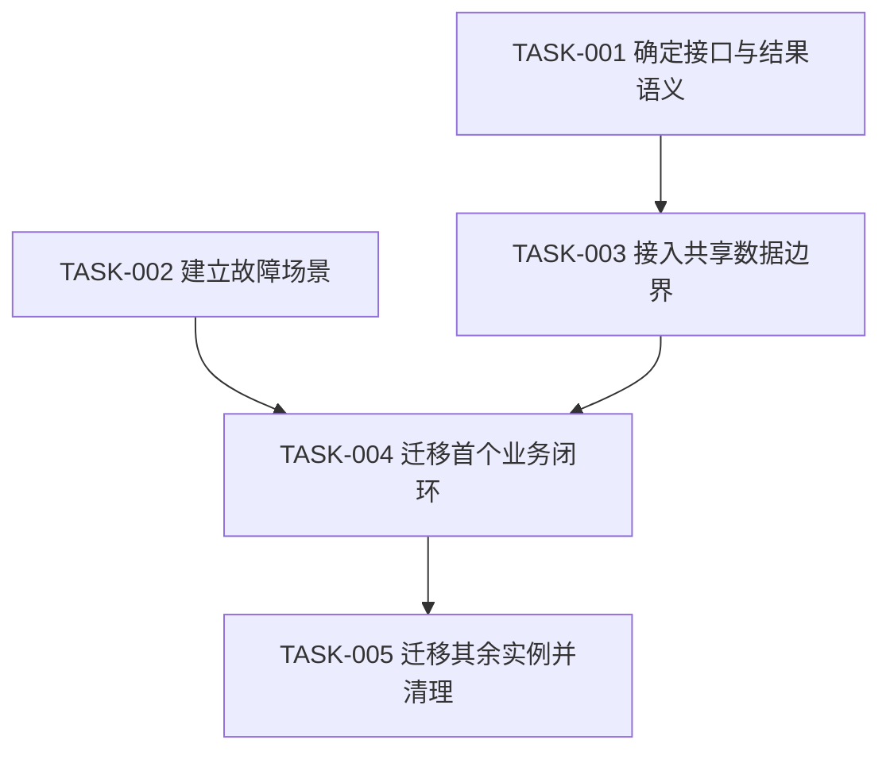

# 逐组件生产重构方案

将审查证据转成可实施、可验收、可回滚的计划。默认使用 `audit_plan`，只完成审查与方案；当用户已要求修复时使用 `implement`，执行已有授权范围内的修改与必要验证，不重复请求许可。对部署、真实数据修改和其他外部副作用沿用当前授权与工具政策。

沿用 [ledger-contract.md](ledger-contract.md) 的实体与字段。为现有 `PAGE-`、共享定义 `DEF-`、使用实例 `CMP-` 保留身份；用 `BP-` 保存共享组件蓝图，并为每个实例单独填写计划；通过 `SCN-`、`CHK-`、`EV-` 追踪验证，通过 `FND-` 归并根因，通过 `TASK-` 组织实施。不要另造一套账本 schema。

## 目录

- [1. 固定目标与实施边界](#1-固定目标与实施边界)
- [2. 为每个组件给出处置](#2-为每个组件给出处置)
- [3. 写出组件目标合同](#3-写出组件目标合同)
- [4. 归并共享根因与实例影响](#4-归并共享根因与实例影响)
- [5. 建立优先级与依赖图](#5-建立优先级与依赖图)
- [6. 拆分增量迁移阶段](#6-拆分增量迁移阶段)
- [7. 明确后端与外部依赖](#7-明确后端与外部依赖)
- [8. 写出任务与验收合同](#8-写出任务与验收合同)
- [9. 执行修改与回归](#9-执行修改与回归)
- [10. 给出可解释的估算](#10-给出可解释的估算)
- [11. 检查最终方案完整性](#11-检查最终方案完整性)
- [12. 查阅一手资料](#12-查阅一手资料)

## 1. 固定目标与实施边界

先明确用户要达到的产品阶段、可用输入、允许修改的范围、部署环境和必须保持的行为。将未知前提显式列出，但继续完成不依赖它们的审查与方案。

- 保留已证实正确且符合用户目标的视觉和交互意图；不要借生产重构擅自重新设计产品。
- 将“当前缺陷”“原型阶段省略的能力”“新增产品需求”分别解释；不要把所有潜在能力变成上线阻塞。
- 优先沿用现有框架、组件库、数据层和设计系统；只在存在明确不满足项时提出替换。
- 对替换说明具体限制、候选能力、迁移成本、依赖兼容性和退出路径；不要仅凭流行程度推荐新技术栈。
- 将无法读取的路由、账号角色、后端代码、生产流量与设备范围列为覆盖限制；不得把没有检查写成通过。
- 将尚未证实的高影响风险转成先行验证任务，不根据猜测安排全系统重写。

区分可交付的前端修复与端到端成立的产品结果。若服务器缺少关键协议，先安排接口依赖和诚实的前端过渡表现。

## 2. 为每个组件给出处置

为范围内每个 `CMP-` 创建且只创建一条 `component_plans`，给出主处置及依据；将定义的当前与目标合同另写为 `component_blueprints` 中的 `BP-`，让实例计划引用它。没有发现缺陷的实例也记录保留范围、验收与复验场景。允许不同实例对同一共享定义采用不同配置，不要求所有实例做相同改动。

| 处置 | 选择条件 | 必须写清的交付 |
|---|---|---|
| `retain` 保留 | 当前职责、行为和验证满足目标 | 保留哪些行为、依据本实例哪些证据、对应验收与复验场景 |
| `configure` 配置调整 | 已有组件能力足够，问题来自调用参数、变体、语义或 token 接入 | 修改哪个入口/配置，影响哪些实例，如何验证默认值与例外 |
| `refactor` 内部重构 | 对外行为可保留，但状态、数据、副作用或职责组织导致缺陷/变更困难 | 调整后的内部边界、兼容接口、迁移消费者顺序与回滚方式 |
| `replace` 替换实现 | 当前实现缺失关键能力或维护代价已得到证实 | 新实现如何覆盖原行为、适配器与差异、依赖成本、替换顺序 |
| `remove` 删除 | 已证实无使用者、重复职责或目标明确取消该能力 | 所有消费者/角色/开关检查、替代路径、清理范围与撤回方式 |
| `investigate` 补证 | 缺源码、运行、契约等证据，尚不能确定实现处置 | 缺少什么、补证任务、所需场景、确认后如何选择处置；目标未知项明确待确认 |

为 `configure/refactor/replace/remove/investigate` 关联 `TASK-`。对每个实例保留非空验收和复验场景；`investigate` 只表示补证安排，不表示已有确定的重构实现。

需要移动、合并或拆分时，将其作为上述处置的具体操作描述；保留来源与目标定义的映射，不随意丢弃历史身份。

对同一组件存在多个问题时，优先给出一套相容目标方案；不要为每条 `FND-` 生成互相冲突的重写建议。

避免以下空泛结论：

- 将“优化状态管理”改成具体状态拥有者、转换和数据失效规则。
- 将“抽成公共组件”改成哪些行为真正相同、哪些参数化、哪些差异应保留。
- 将“统一样式”改成实际 token、变体、作用域和需要清理的冲突规则。
- 将“增强可访问性”改成角色、名称、键盘动作、焦点、状态播报与可执行验收。
- 将“增加测试”改成要防止回归的用户结果和对应 `SCN-`/`CHK-`。

## 3. 写出组件目标合同

在 `BP-` 中分开填写 `current_contract` 与 `target_contract`，并给出实际 `change_locations`；不要把预期目标写成已存在能力。按协议补齐目标合同全部维度；对静态叶子简短说明适用范围，对缺证据部分标待确认，不编造函数签名。

在每个实例计划的 `instance_changes` 中描述该位置的差异，另写验收和复验场景。对简单 `configure` 引用共享蓝图，只展开本实例变化，避免复制整份合同。

| 方案维度 | 必须回答的问题 |
|---|---|
| 现状定位 | 它在哪些页面、角色和状态出现？现有源码/样式/调用点在哪里？ |
| 当前职责 | 它实际承担呈现、表单、请求、路由、权限还是后台订阅？哪些职责混在一起造成问题？ |
| 目标职责 | 改后负责什么？将哪些职责交给哪个已命名边界？为什么这样划分？ |
| 输入与输出 | 哪些输入必须提供、可以为空、只初始化一次？事件/回调代表意图、已提交还是已完成？ |
| 状态合同 | 哪些状态由调用方控制、组件内部持有、服务器拥有或从 URL 读取？何时保留/重置？ |
| 数据与副作用 | 谁请求、谁缓存、谁重试、谁取消订阅、谁更新相关视图？失败和未知结果如何恢复？ |
| 样式与 token | 使用哪些现有语义 token、尺寸/密度/状态变体？如何避免全局 CSS、优先级与级联冲突？ |
| 可访问性 | 采用什么语义、可访问名称、键盘操作、焦点进入/返回、错误关联和播报规则？ |
| 性能与生命周期 | 哪些渲染、订阅、资源与清理约束适用？预算和验证条件是什么？ |
| 安全与隐私 | 输入与输出跨越哪些信任边界？依赖什么授权保证？保留哪些必要数据？ |
| 可观测性 | 需要哪些错误、事件与诊断线索？如何关联执行并脱敏？静态叶子是否无需独立事件？ |
| 复用与差异 | 复用哪个 `DEF-`？哪些 `CMP-` 共用行为，哪些需要明确配置或独立实现？ |
| 兼容与迁移 | 原调用方式如何过渡？先迁移哪些消费者？如何识别遗漏调用点？ |
| 验收与回滚 | 哪些场景证明结果？失败后恢复旧实现是否仍兼容新数据与接口？ |

### 避免表面复用

先比较行为合同，再比较外观。两个卡片外观相同但数据来源、选择语义和权限不同，可以共用呈现基础而保留各自业务控制。

对受控/非受控模式、默认值、禁用/只读、提交完成事件和异步状态写清约束；不要靠多个布尔 props 拼出无效组合。

保持样式作用域可解释；检查 token 替换后 hover、focus、disabled、error、loading、暗色和高对比模式等适用状态。只有实际存在这些模式时才要求对应实现。

不要把增加一层 wrapper 视为完成解耦；验证接口变化能否在局部处理，实例间是否还能各自独立演进。

### 示例：将任务动作从视觉按钮变成明确合同

将以下内容视为方案写法示例，不登记成项目事实：

- 将共享动作定义的职责限定为呈现名称、可用性和待确认反馈；让业务动作层拥有作业身份与取消结果。
- 将按钮输出定义成“用户请求取消该运行”，避免命名成“取消已完成”；由服务器状态更新决定终态文案。
- 将列表实例与详情实例映射到同一动作合同；让各自布局、说明文案和焦点返回位置通过明确参数配置。
- 先补齐可回放的取消被拒绝、响应丢失、取消与完成竞争场景，再迁移一个列表实例和一个详情实例。
- 将后端取消协议作为独立依赖；在协议未完成时显示待确认状态，不伪造“已停止”。

## 4. 归并共享根因与实例影响

按根因创建 `FND-`，按页面实例保存实际表现；同一公共弹窗缺失焦点约束，不要因 20 个调用点制造 20 个独立根因，也不要因此跳过 20 个实例的影响说明。

建立可双向追踪的关系：

1. 从 `FND-` 追到产生问题的 `DEF-`、数据边界、样式规则或协议。
2. 从根因追到所有已发现的 `CMP-`、所在 `PAGE-` 与相关 `SCN-`。
3. 对每个实例说明是否运行复现、静态证据能证明什么及仍待验证的影响，并引用对应 `EV-`。将这些写为影响说明；检查状态与发现置信度严格使用主账本词表，不另造枚举。
4. 从 `TASK-` 追到解决的根因与迁移的具体实例，不只写“修复公共组件”。
5. 从验收 `CHK-` 追到每个需要验证的实例或有依据的等价组；待验证风险对应 `blocked/not_checked` 检查，不把它填成 `failed`。

| 影响映射维度 | 记录要求 |
|---|---|
| 共性 | 指出共享代码/配置如何导致问题；引用最直接证据 |
| 实例差异 | 列出不同 props、容器、路由、角色、焦点起点和数据来源 |
| 修改传播 | 说明一次定义修改自动覆盖哪些调用点，哪些需手工迁移 |
| 回归风险 | 指出旧依赖、特殊变体、CSS 覆盖和自定义事件处理 |
| 覆盖结论 | 只对实际验证范围下结论；不要把代表性样本冒充全实例通过 |

在同一根因跨前端/后端时保留关联任务；分别证明每一侧的完成条件。采用 `accepted_risk/dismissed` 时记录协议要求的决定理由与授权来源，不由审查代理自行接受已确认风险。

## 5. 建立优先级与依赖图

沿用主账本的严重度和优先级词表。按具体影响排序，而非简单把安全最高、可访问性或样式全部最低。

- 优先处理已证实的数据越权、错误对象操作、数据丢失、重复高成本操作和关键流程无法完成。
- 将关键路径上的键盘不可达、读屏不可理解和错误状态无法恢复按真实用户阻断程度排序。
- 将共享根因的传播范围、发生条件、可恢复性和暴露频率纳入顺序；没有使用数据时标明估计。
- 将高影响但证据不足的问题排为验证任务；不要把“未知”自动降成低优先级，也不要写成已发生事故。
- 把视觉精度、次要一致性与便利性改进放在已确认业务约束之后，除非它们本身造成误操作或访问阻断。

为每个 `TASK-` 写出前置任务、可并行任务和阻塞原因，生成无环依赖关系。检查是否存在“前端等后端、后端又等前端”的循环，并用契约约定或隔离验证拆开。

采用下列关系作为示例，按项目真实任务替换；不要预先创建这些编号：

将能独立完成的语义标记、局部样式配置、场景构造等安排并行，但不要在接口合同未稳定时让多个页面各自发明协议。

## 6. 拆分增量迁移阶段

围绕可完整验收的业务闭环拆分，而非先重写所有基础设施再开始交付。

| 阶段 | 输出 | 退出条件 |
|---|---|---|
| 建立基线 | 现有行为、覆盖边界、关键失败场景、必要契约决策 | 能重现关键问题并判断修复是否有效 |
| 解除关键阻断 | 最小范围修复、关键接口或身份边界、必要过渡反馈 | 严重错误被实际阻止或明确隔离 |
| 迁移首个闭环 | 一个页面/流程及其共享依赖、兼容适配、完整验收 | 正常、失败、恢复与关键组合均符合合同 |
| 扩展到其他实例 | 显式消费者清单、差异配置、实例迁移记录 | 范围内消费者均已迁移或有说明地保留 |
| 清理与收口 | 删除已无消费者的旧路径、统一文档/契约、最终回归 | 无悬空调用、无未说明双写、覆盖结论可信 |

只在确有并行版本或发布需求时使用兼容适配、功能开关、灰度或双读；不要给小项目强加迁移基础设施。

对临时适配写明移除条件；避免为了“过渡”永久保存两份业务规则。涉及双写时先论证一致性与重复执行风险，不默认采用。

逐步替换页面中的旧实现；保持中间提交可运行。若必须跨多个模块一次改变，说明无法拆分的约束与最小切换边界。

将不可逆数据迁移与可逆 UI 修改分开。代码回滚不能恢复已删除的数据或撤销已发送消息；对相关动作明确真正的恢复机制。

## 7. 明确后端与外部依赖

对以下问题建立独立且可归责的任务：服务端授权、幂等、版本冲突、真实取消、异步作业查询、持久化、流式事件身份、上传校验、导出范围和配额约束。

每个依赖至少写清：

- 前端已观察到的问题与证据，以及它阻塞的 `PAGE-`/`CMP-`/`SCN-`。
- 所需业务保证与接口请求/结果语义；已有契约不存在时标明为待商定提案。
- 负责的角色或团队；未知时写待分配，不编造人员。
- 前端能够独立实现的部分、可验证的临时行为和仍不能承诺的结果。
- 提供方交付条件、调用方集成条件与端到端验收方式。
- 失败或延期时可接受的降级/隔离方案及其用户影响。

不要通过前端隐藏、固定延时、内存标记或 `AbortController` 冒充服务端授权、幂等和业务取消。

当用户要求修复时，先完成已授权且不依赖外部交付的部分；保留具体阻塞任务，不因一项外部依赖停止全部工作。

## 8. 写出任务与验收合同

让每个 `TASK-` 小到能够说明修改范围、完成结果与回滚点；不要用“全量工程化”“重构前端”作为唯一任务。

按主账本填写以下内容，不另定义序列化格式：

将 `PRJ-/PAGE-/DEF-/CMP-` 放入任务 `scope_ids`，将 `FND-` 放入 `finding_ids`，将前置 `TASK-` 放入 `depends_on`，将 `SCN-` 放入 `verification_scenario_ids`，将已发生的 `EV-` 放入 `evidence_ids`。不要把场景或证据 ID 混入作用范围，也不要把待执行检查冒充证据。

| 内容 | 要求 |
|---|---|
| 目标 | 用用户可观察结果描述为什么做 |
| 关联 | 列出 `FND-`、`DEF-`、`CMP-`、`PAGE-` 与关键 `SCN-` |
| 修改范围 | 指定真实文件/符号/配置；未取得源码时给目标边界并标明待定位 |
| 实施动作 | 说明具体添加、调整、迁移或移除的职责与调用点 |
| 前置条件 | 列出契约、测试环境、权限和依赖任务 |
| 不变量 | 写出修改期间必须保持的已授权产品行为 |
| 验收 | 引用 `CHK-`，写正常、故障、恢复与适用跨实例结果 |
| 回归范围 | 指出共享定义的消费者、关联路由和必要环境 |
| 回滚 | 指明恢复路径、兼容前提、数据副作用限制 |
| 完成证据 | 保留实际 diff、运行结果和必要 `EV-`；计划中的检查不能充当通过记录 |

将验收写成可以观察的断言。例如将“解决竞态”写成“在 B 响应后再返回 A 响应，输入、列表和详情仍对应 B”；将“支持取消”写成“取消待确认时显示处理中，只有服务端终态确认后显示已取消”。

不要规定每个轻微修改都新增测试文件。复用已有自动化、定向运行和可回放场景；仅为明确回归风险补测试，不编写照抄实现的测试。

## 9. 执行修改与回归

在 `audit_plan` 模式停留于证据、处置和可执行计划；在用户已授权的 `implement` 模式中，继续完成实现、验证、账本更新与交付，不增加默认审批关卡。

1. 读取目标模块与现有约束，确认正在修改计划中的对象；保留用户已有改动。
2. 先修共享根因或约定边界，再迁移一个有代表性的闭环；避免同时改主题、框架、路由和数据协议。
3. 在合适隔离环境执行既定 `SCN-`/`CHK-`，采集必要 `EV-`，并观察正常、失败与恢复路径。
4. 对共享定义按消费者差异选择回归；对高影响实例直接验证，等价抽样则说明等价依据和未覆盖实例。
5. 将新增问题关联原根因或新建证据充分的 `FND-`；调整依赖与后续任务，避免边做边无界扩张。
6. 迁移剩余实例后搜索旧调用、重复规则、过渡样式和未清理副作用；仅删除已证实无消费者的内容。
7. 对计划与实际实现核对完成范围；把未验证、阻塞和已完成分别写清。

沿用任务状态 `planned/in_progress/implemented/verified/blocked/deferred`；只有实际验证证据才能支持 `verified`。问题修复后先区分 `fixed_unverified` 与 `resolved`，保留修复前证据，并用 `resolution_evidence_ids` 关联复验结果。

只扩展验证以解决具体剩余风险或满足项目门槛。验证充分后停止可选重复测试，继续完成交付。

将发布与合并等动作按原请求、仓库规则及工具权限处理；只有确实需要新的许可时，展示已完成且可审阅的具体结果，并说明要求许可的来源。

## 10. 给出可解释的估算

仅在用户需要排期或信息足以支持时估时；否则提供任务相对规模、依赖和先后关系。

将每个时间数字标为 **粗略估算**，同时给出 **置信度：高/中/低**、主要假设、范围及不确定来源。例如写“**粗略估算：2–4 人日；置信度：低**，假设现有接口可复用，暂未检查历史消费者”。不要输出无依据的精确日期或百分比。

- 分开估算实现、验证、外部等待和可能返工，不把等待后端等同于前端工时。
- 不根据文件数、行数或组件数简单线性换算工期；共享根因可减少重复实现，但跨实例验证仍有成本。
- 对未知契约、无法启动、依赖冲突和覆盖缺口，先安排调查任务并在取得证据后更新估算。
- 将并行能力与关键路径分开；不要简单相加工时后声称是日历工期。
- 说明区间扩大/缩小的触发条件；不要以高置信度语言掩盖未读代码和未验证环境。

## 11. 检查最终方案完整性

交付前按实体清单逐项核对：

- 每个范围内 `PAGE-` 均有覆盖结论、关键状态和剩余限制。
- 每个 `CMP-` 有且只有一条实例计划并引用有效 `BP-`；每份蓝图分开记录当前/目标合同及变更位置。
- 每个实例都有明确处置、本位置的改动或保留理由、非空验收与复验场景；证据阻塞时使用 `investigate` 并链接补证任务。
- 每个 `FND-` 有证据、影响、处置或经授权的保留/排除决定，不以“建议优化”结束。
- 每个需要实施的问题均能追到 `TASK-`，每个任务均有范围、依赖、验收和可行回滚。
- 共享修改覆盖的实例与实际验证实例分别列清，没有把复用映射当测试结果。
- 前后端及其他外部依赖有提供方、需要的保证和未完成影响，没有被前端补丁掩盖。
- 迁移顺序无循环，阶段有退出条件，临时方案有移除条件。
- 估算均标粗略与置信度；未知信息没有被填成虚构事实。
- 在已授权修复模式下，报告实际改动、实际验证和剩余事项；在计划模式下，不声称已经修复或可直接上线。

使最终答复同时包含用户能理解的核心结论和完整可追踪的方案。避免只有一份问题清单，没有逐组件处置；也避免只有架构愿景，没有迁移与验收步骤。

## 12. 查阅一手资料

按项目实际技术栈与版本验证具体实现；使用官方资料支持关键接口、样式和交互合同。

- [React：Thinking in React](https://react.dev/learn/thinking-in-react)
- [React：Sharing State Between Components](https://react.dev/learn/sharing-state-between-components)
- [React：You Might Not Need an Effect](https://react.dev/learn/you-might-not-need-an-effect)
- [MDN：CSS cascade](https://developer.mozilla.org/en-US/docs/Web/CSS/Guides/Cascade/Introduction)
- [WAI-ARIA Authoring Practices Guide](https://www.w3.org/WAI/ARIA/apg/)
- [OpenAPI Specification](https://spec.openapis.org/oas/latest.html)
- [HTTP Semantics：RFC 9110](https://httpwg.org/specs/rfc9110.html)
